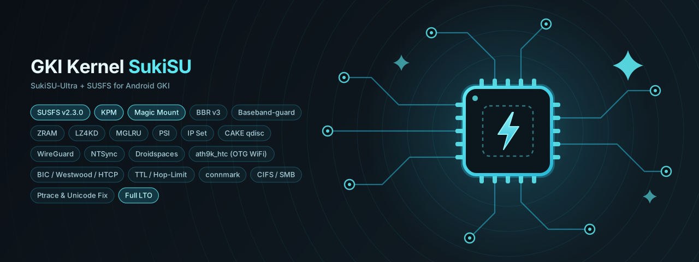

<p align="center"></p>

# GKI Kernel SukiSU-Ultra + SUSFS - Poco F6 Pro

A **GKI kernel** with **SukiSU-Ultra** (root) and **SUSFS** (root hiding) built in, plus networking, memory and container extras. Built, flashed and daily-driven on the **Poco F6 Pro / Redmi K70 (`vermeer`)**, and published together with the build system that makes it.

Download the latest build from **[Releases](https://github.com/nikakvo/GKI_Kernel_SukiSU/releases)**. Each release lists its exact kernel, SukiSU-Ultra and SUSFS versions and the matching manager.

**Have a question? Read the [FAQ](#faq) first - the common ones are answered there.**

---

<a id="scope"></a>
## ⚠️ Scope - read this first

| Target | Status |
|--------|--------|
| `android13-5.15` on `vermeer` (Poco F6 Pro / K70), clean Xiaomi.eu HyperOS | **Built, flashed, tested, daily-driven.** This is the project. |
| Other `android13-5.15` devices / ROMs | Standard GKI, so it may boot, but **untested** - your risk. |
| `android12-5.10`, `android14-6.1`, `android15-6.6` | The scripts can build them, **untested** on a device. |
| Non-GKI devices | Not supported. |

**Personal build.** I build this kernel for my own phone on clean Xiaomi.eu HyperOS and share it as is, **without support**. Other ROMs (including CN/Global), modified systems and other module setups are not tested. If something doesn't work for you, flash your stock `boot.img` back. Please don't open issues or report problems from other setups.

**Always keep a working `boot.img` backup before flashing.**

---

## Features

| Feature | What it gives you |
|---------|-------------------|
| **[SukiSU-Ultra](https://github.com/SukiSU-Ultra/SukiSU-Ultra)** | Kernel-level root (built in, not LKM), with module preinit support |
| **[SUSFS v2.3.0](https://github.com/ShirkNeko/susfs4ksu)** | Kernel-side root hiding (paths, mounts, uname/cmdline spoofing). Needs the [userspace module](#susfs-userspace) |
| **KPM** | Load KernelPatch modules at runtime |
| **BBR v3** | Newer TCP congestion control (falls back to BBR v1 if the patch doesn't fit) |
| **BIC, Westwood+, H-TCP** | Extra congestion control algorithms to switch to at runtime |
| **CAKE qdisc** | Less bufferbloat, lower latency under load |
| **WireGuard** | In-kernel WireGuard VPN (always-on tunnel without an app: [WG Shield](https://github.com/nikakvo/wg-shield-arm64)) |
| **[AmneziaWG](https://github.com/amnezia-vpn/amneziawg-linux-kernel-module)** | WireGuard with DPI obfuscation, built in next to WireGuard. Use it with [WG Shield](https://github.com/nikakvo/wg-shield-arm64) 2.0+ (the AmneziaWG app falls back to userspace for AmneziaWG configs) |
| **IP Set** | Fast IP/network sets for iptables (userspace binary: [ipset-arm64](https://github.com/nikakvo/ipset-arm64)) |
| **TTL / Hop-Limit, CONNMARK** | Netfilter targets for hotspot TTL normalisation and policy routing |
| **CIFS/SMB** | Mount Windows/Samba shares directly |
| **ZRAM + LZ4KD** | Better ZRAM compression (also LZ4K, LZ4HC, deflate, 842, lz4k_oplus) |
| **MGLRU + PSI** | Modern memory reclaim and pressure stats for smarter LMKD |
| **Full LTO** | Release builds use Full LTO (CI builds Thin LTO) |
| **[Droidspaces](https://github.com/ravindu644/Droidspaces-OSS)** | Real Linux containers (PID/IPC/mount/user namespaces, macvlan, pids cgroup), kABI-safe |
| **NTSync** | `/dev/ntsync` for Wine/Winlator |
| **[Baseband-guard](https://github.com/vc-teahouse/Baseband-guard)** | Blocks unauthorised writes to modem/baseband partitions |
| **Ptrace leak fix, Unicode fix** | Upstream backports (ptrace race, UTF-8 normalisation bypass) |
| **ath9k_htc** | TP-Link TL-WN722N **v1** over OTG: monitor mode + injection, internal WiFi keeps working ([details](ath9k-module/README.md)) |

### Check what is active

Every release ships **`check-features.sh`** (also in the repo root). It reads the kernel config and the live `/proc` and `/sys` state and prints one line per feature: `OK`, `MISSING` (please report), `NOT BUILT` (off in this build) or `N/A` (can't be checked on the device).

Copy it out of `/sdcard` first - under `su` the shared storage is invisible or `noexec`. In Termux:

```bash
cp /sdcard/Download/check-features.sh ~
chmod +x ~/check-features.sh
su -c "$HOME/check-features.sh"
```

Add `-v` to see the measured values, or `--no-color` for text to paste into an issue.

---

## Installation

1. Back up your current `boot.img`.
2. Flash **one** of the two:
   - **boot.img** over fastboot (from the bootloader, `adb reboot bootloader`):
     ```bash
     fastboot boot <boot.img>          # try it once, nothing is written
     fastboot flash boot_ab <boot.img> # install on both slots
     ```
   - **AnyKernel3 zip** from a custom recovery or a kernel flasher app such as [HorizonKernelFlasher](https://github.com/libxzr/HorizonKernelFlasher/releases).
3. Install the **SukiSU-Ultra manager named in the release notes**. Kernel and manager must report the same version number, otherwise the manager shows a mismatch. The official tagged manager APK usually does **not** match - use the one linked in the release.
4. Open the manager: it should show **Working** and **Built-in**.

<a id="susfs-userspace"></a>
### SUSFS userspace module

The kernel side of SUSFS is already built in, but nothing gets hidden without the userspace module. Flash **[sidex15/susfs4ksu-module](https://github.com/sidex15/susfs4ksu-module)** in the manager (the tested build is attached to every release), reboot, and configure it there.

### Emergency recovery

If the phone does not boot: hold **Power + Volume Down** for fastboot and flash your backup:

```bash
fastboot flash boot_ab <your-backup-boot.img>
```

---

## FAQ

1. [Does it pass Duck Detector (or any other detector)?](#faq-detectors)
2. [How do I install it?](#faq-install)
3. [Will it work on my device / ROM?](#faq-device)
4. [What is Full LTO? Is it different from Thin LTO or no LTO?](#faq-lto)
5. [The manager shows a version mismatch](#faq-manager)
6. [How do I know a feature is working?](#faq-features)
7. [My phone doesn't boot after flashing](#faq-noboot)
8. [Can you add support for my device or build it for me?](#faq-support)

<a id="faq-detectors"></a>
### 1. Does it pass Duck Detector (or any other detector)?

I don't run detector apps and I don't publish detector results. The test that matters here is real life: on my setup, Google Wallet, Revolut, PayPal and banking apps all work every day.

Detector apps are made to find every possible trace of root or kernel changes, far more than any real app checks. Chasing a clean detector score often means breaking a setup that already works, just to make one test app happy. That is not the goal of this kernel.

The kernel gives you the tools (SukiSU-Ultra and the SUSFS kernel side). What gets hidden depends on the [SUSFS userspace module](#susfs-userspace) and how you configure it, not on the kernel alone.

**A green screen in a detector doesn't pay your bills.** 😄

<a id="faq-install"></a>
### 2. How do I install it?

Everything is in [Installation](#installation): back up your `boot.img`, flash the `boot.img` or the AnyKernel3 zip, install the manager named in the release notes, then flash the SUSFS userspace module.

<a id="faq-device"></a>
### 3. Will it work on my device / ROM?

See [Scope](#scope). Only `vermeer` (Poco F6 Pro / K70) on clean Xiaomi.eu HyperOS is tested. Other `android13-5.15` GKI devices may boot, but that is untested and at your own risk. Try it first with `fastboot boot <boot.img>` - nothing is written, and a reboot brings your old kernel back.

<a id="faq-lto"></a>
### 4. What is Full LTO? Is it different from Thin LTO or no LTO?

LTO (Link Time Optimization) is how the compiler optimizes the kernel when it is put together:

| Mode | What it means |
|------|---------------|
| **No LTO** | Every source file is optimized on its own. |
| **Thin LTO** | Optimizes across files in parallel chunks. Fast to build, needs less RAM. |
| **Full LTO** | Optimizes the whole kernel as one unit. Slightly tighter code, but needs ~27 GB RAM and a much longer build. |

The features are the same in all modes. Release builds are Full LTO; GitHub Actions builds are Thin LTO.

<a id="faq-manager"></a>
### 5. The manager shows a version mismatch

Use the **SukiSU-Ultra manager linked in the release notes**. The official tagged manager APK usually reports a different version number than the kernel.

<a id="faq-features"></a>
### 6. How do I know a feature is working?

Run [`check-features.sh`](#check-what-is-active). It prints `OK`, `MISSING`, `NOT BUILT` or `N/A` for every feature.

<a id="faq-noboot"></a>
### 7. My phone doesn't boot after flashing

Hold **Power + Volume Down** for fastboot and flash your backup - see [Emergency recovery](#emergency-recovery).

<a id="faq-support"></a>
### 8. Can you add support for my device or build it for me?

No. This is a personal build for my own phone, shared as is, without support. The whole build system is in this repo - see [Building it yourself](#building-it-yourself) to build for your own kernel version.

---

## Building it yourself

Local build in Ubuntu / WSL. Dependencies are installed automatically.

```bash
git clone https://github.com/nikakvo/GKI_Kernel_SukiSU
cd GKI_Kernel_SukiSU
./build-kernel.sh            # menu: 1) tested default, 2) custom, 3) all from matrix.json
./cleanup-workspace.sh       # free disk space between builds
```

Every build starts from a clean tree: if `~/gki-workspace/<android>-<kernel>-<sub_level>` still holds a previous (or interrupted) build, it is deleted first, and that build's zips, boot images and `ath9k-modules/` are moved to `~/gki-workspace/previous-<android>-<kernel>-<sub_level>/` (only the last one is kept). `cleanup-workspace.sh` is still there to free the disk space by hand. After a successful build, the same folder also holds everything a release needs: the boot image, the AnyKernel3 zip, the flashable `ath9k_htc_vermeer.zip` (packed by `ath9k-module/make-ath9k-module.sh`), `check-features.sh`, a copy of the build log, `PATCH_STATUS.json` and `BUILD_REPORT.txt`.

With no flags it builds **exactly the SukiSU-Ultra / SUSFS combination of the latest release**. The pins live at the top of `.github/workflows/scripts/config.py`.

Useful `build-kernel.sh` options:

| Option | Meaning |
|--------|---------|
| `--no-pids` | Build without `CONFIG_CGROUP_PIDS` for Droidspaces (it is on by default, android13-5.15) |
| `--kpm-legacy` | Old KPM patcher (KernelPatch 0.13.0) for SukiSU 41083 and older. Default is the pinned KernelPatch (0.14.0, KPM bridge ABI 2), which current SukiSU needs |
| `--ksu-commit <ref>` | Other SukiSU-Ultra commit / tag / `main` |
| `--ksu-version-code <n>` | Version number the kernel reports - must match your manager |
| `--susfs-commit <ref>` | Other susfs commit, `branch=hash,...`, or `latest` |
| `--no-ath9k` | Skip the ath9k_htc modules |
| `--no-amneziawg` | Build without AmneziaWG |
| `--amneziawg-commit <sha>` | Other amneziawg-linux-kernel-module commit (full SHA) |

### Checking for updates: `check-release.sh`

SukiSU-Ultra and SUSFS move fast, and the newest commits don't always fit together. `check-release.sh` finds the newest SukiSU-Ultra and susfs commits, applies the SUSFS patch in a throwaway tree with the same recovery code the build uses, and prints the exact build command. Hunks that `patch` could only apply with fuzz are checked too: code that landed outside a function stops it, anything new is shown as a warning. It checks the newest AmneziaWG commit the same way; one that doesn't fit is left out and the build keeps the last working one:

- **OK ... Build this** - new combination, patches cleanly.
- **OK ... You're up to date** - nothing new.
- **STOP** - upstream changed something the pipeline doesn't handle yet; the last working command is printed instead.

After you build, flash and test, run it again and answer `1` to save the new pins in `config.py` (or `3` to blacklist a broken combination).

### GitHub Actions

The **Kernel Build** (one version) and **Build Kernels** (whole matrix) workflows use the same pins when their inputs are left empty. With all its fields left as they are, **Kernel Build** builds the same kernel as `./build-kernel.sh` with no flags (android13-5.15.223, AmneziaWG, ath9k_htc modules included). CI builds **Thin LTO** (Full LTO needs ~27 GB RAM), so they are not the tested release binaries. The **Check Release** workflow runs `check-release.sh` and writes on its Summary page what to put into Kernel Build for the newest commits that fit.

Kernel versions and Google tags come from `.github/workflows/config/matrix.json`, kept current by `update_matrix.py` and the scheduled **update-matrix** workflow. A sub_level that has no Google tag yet (like 223) is pinned to the newest commit for it on the `-lts` branch, and the default build uses that commit.

---

## Credits

- **[ShirkNeko/GKI_KernelSU_SUSFS](https://github.com/ShirkNeko/GKI_KernelSU_SUSFS)** - the build system this started as a fork of.
- **[SukiSU-Ultra](https://github.com/SukiSU-Ultra/SukiSU-Ultra)** and **[SukiSU_patch](https://github.com/SukiSU-Ultra/SukiSU_patch)** - root implementation, KPM and extra patches (ZRAM, hooks).
- **[susfs4ksu](https://gitlab.com/simonpunk/susfs4ksu)** (via [ShirkNeko/susfs4ksu](https://github.com/ShirkNeko/susfs4ksu)) - SUSFS.
- **[WildKernels/kernel_patches](https://github.com/WildKernels/kernel_patches)** - BBRv3 backport.
- **[amnezia-vpn/amneziawg-linux-kernel-module](https://github.com/amnezia-vpn/amneziawg-linux-kernel-module)** - AmneziaWG.
- **[ravindu644/Droidspaces-OSS](https://github.com/ravindu644/Droidspaces-OSS)** - Droidspaces app and kABI-safe patches.
- **[vc-teahouse/Baseband-guard](https://github.com/vc-teahouse/Baseband-guard)**, **[AnyKernel3](https://github.com/WildPlusKernel/AnyKernel3)**.

## License

This repository's own files are [GPL-3.0-or-later](LICENSE). Kernel patches, firmware and the released kernel images keep their own licenses (GPL-2.0 for kernel code) - see [THIRD_PARTY_NOTICES.md](THIRD_PARTY_NOTICES.md).
