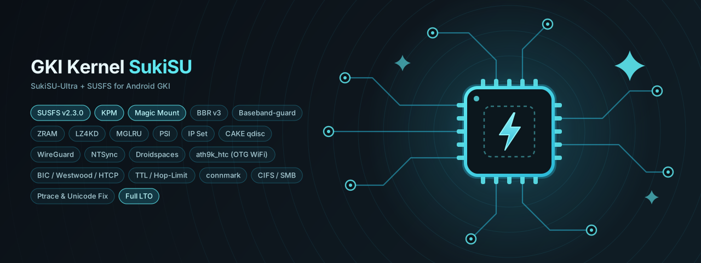

<p align="center"></p>

# GKI Kernel SukiSU-Ultra + SUSFS - Poco F6 Pro

A **GKI kernel** with **SukiSU-Ultra** (root) and **SUSFS** (root hiding) built in, plus networking, memory and container extras. Built, flashed and daily-driven on the **Poco F6 Pro / Redmi K70 (`vermeer`)**, and published together with the build system that makes it.

Download the latest build from **[Releases](https://github.com/nikakvo/GKI_Kernel_SukiSU/releases)**. Each release lists its exact kernel, SukiSU-Ultra and SUSFS versions and the matching manager.

---

## ⚠️ Scope - read this first

| Target | Status |
|--------|--------|
| `android13-5.15` on `vermeer` (Poco F6 Pro / K70), clean Xiaomi.eu HyperOS | **Built, flashed, tested, daily-driven.** This is the project. |
| Other `android13-5.15` devices / ROMs | Standard GKI, so it may boot, but **untested** - your risk. |
| `android12-5.10`, `android14-6.1`, `android15-6.6` | The scripts can build them, **untested** on a device. |
| Non-GKI devices | Not supported. |

**Always keep a working `boot.img` backup before flashing.**

---

## Features

| Feature | What it gives you |
|---------|-------------------|
| **[SukiSU-Ultra](https://github.com/SukiSU-Ultra/SukiSU-Ultra)** | Kernel-level root (built in, not LKM), with module preinit support |
| **[SUSFS v2.3.0](https://github.com/ShirkNeko/susfs4ksu)** | Kernel-side root hiding (paths, mounts, uname/cmdline spoofing). Needs the [userspace module](#susfs-userspace) |
| **KPM** | Load KernelPatch modules at runtime |
| **BBR v3** | Newer TCP congestion control (falls back to BBR v1 if the patch doesn't fit) |
| **BIC, Westwood+, H-TCP** | Extra congestion control algorithms to switch to at runtime |
| **CAKE qdisc** | Less bufferbloat, lower latency under load |
| **WireGuard** | In-kernel WireGuard VPN |
| **[AmneziaWG](https://github.com/amnezia-vpn/amneziawg-linux-kernel-module)** | WireGuard with DPI obfuscation, built in next to WireGuard; works with the AmneziaWG app in kernel mode |
| **IP Set** | Fast IP/network sets for iptables (userspace binary: [ipset-arm64](https://github.com/nikakvo/ipset-arm64)) |
| **TTL / Hop-Limit, CONNMARK** | Netfilter targets for hotspot TTL normalisation and policy routing |
| **CIFS/SMB** | Mount Windows/Samba shares directly |
| **ZRAM + LZ4KD** | Better ZRAM compression (also LZ4K, LZ4HC, deflate, 842, lz4k_oplus) |
| **MGLRU + PSI** | Modern memory reclaim and pressure stats for smarter LMKD |
| **Full LTO** | Release builds use Full LTO (CI builds Thin LTO) |
| **[Droidspaces](https://github.com/ravindu644/Droidspaces-OSS)** | Real Linux containers (PID/IPC/mount/user namespaces, macvlan, pids cgroup), kABI-safe |
| **NTSync** | `/dev/ntsync` for Wine/Winlator |
| **[Baseband-guard](https://github.com/vc-teahouse/Baseband-guard)** | Blocks unauthorised writes to modem/baseband partitions |
| **Ptrace leak fix, Unicode fix** | Upstream backports (ptrace race, UTF-8 normalisation bypass) |
| **ath9k_htc** | TP-Link TL-WN722N **v1** over OTG: monitor mode + injection, internal WiFi keeps working ([details](ath9k-module/README.md)) |

### Check what is active

Every release ships **`check-features.sh`** (also in the repo root). It reads the kernel config and the live `/proc` and `/sys` state and prints one line per feature: `OK`, `MISSING` (please report), `NOT BUILT` (off in this build) or `N/A` (can't be checked on the device).

Copy it out of `/sdcard` first - under `su` the shared storage is invisible or `noexec`. In Termux:

```bash
cp /sdcard/Download/check-features.sh ~
chmod +x ~/check-features.sh
su -c "$HOME/check-features.sh"
```

Add `-v` to see the measured values, or `--no-color` for text to paste into an issue.

---

## Installation

1. Back up your current `boot.img`.
2. Flash **one** of the two:
   - **boot.img** over fastboot (from the bootloader, `adb reboot bootloader`):
     ```bash
     fastboot boot <boot.img>          # try it once, nothing is written
     fastboot flash boot_ab <boot.img> # install on both slots
     ```
   - **AnyKernel3 zip** from a custom recovery or a kernel flasher app such as [HorizonKernelFlasher](https://github.com/libxzr/HorizonKernelFlasher/releases).
3. Install the **SukiSU-Ultra manager named in the release notes**. Kernel and manager must report the same version number, otherwise the manager shows a mismatch. The official tagged manager APK usually does **not** match - use the one linked in the release.
4. Open the manager: it should show **Working** and **Built-in**.

<a id="susfs-userspace"></a>
### SUSFS userspace module

The kernel side of SUSFS is already built in, but nothing gets hidden without the userspace module. Flash **[sidex15/susfs4ksu-module](https://github.com/sidex15/susfs4ksu-module)** in the manager (the tested build is attached to every release), reboot, and configure it there.

### Emergency recovery

If the phone does not boot: hold **Power + Volume Down** for fastboot and flash your backup:

```bash
fastboot flash boot_ab <your-backup-boot.img>
```

---

## Building it yourself

Local build in Ubuntu / WSL. Dependencies are installed automatically.

```bash
git clone https://github.com/nikakvo/GKI_Kernel_SukiSU
cd GKI_Kernel_SukiSU
./build-kernel.sh            # menu: 1) tested default, 2) custom, 3) all from matrix.json
./cleanup-workspace.sh       # free disk space between builds
```

With no flags it builds **exactly the SukiSU-Ultra / SUSFS combination of the latest release**. The pins live at the top of `.github/workflows/scripts/config.py`.

Useful `build-kernel.sh` options:

| Option | Meaning |
|--------|---------|
| `--pids` | Add `CONFIG_CGROUP_PIDS` for Droidspaces (android13-5.15, used in releases) |
| `--ksu-commit <ref>` | Other SukiSU-Ultra commit / tag / `main` |
| `--ksu-version-code <n>` | Version number the kernel reports - must match your manager |
| `--susfs-commit <ref>` | Other susfs commit, `branch=hash,...`, or `latest` |
| `--no-ath9k` | Skip the ath9k_htc modules |
| `--no-amneziawg` | Build without AmneziaWG |
| `--amneziawg-commit <sha>` | Other amneziawg-linux-kernel-module commit (full SHA) |

### Checking for updates: `check-release.sh`

SukiSU-Ultra and SUSFS move fast, and the newest commits don't always fit together. `check-release.sh` finds the newest SukiSU-Ultra and susfs commits, applies the SUSFS patch in a throwaway tree with the same recovery code the build uses, and prints the exact build command. It checks the newest AmneziaWG commit the same way; one that doesn't fit is left out and the build keeps the last working one:

- **OK ... Build this** - new combination, patches cleanly.
- **OK ... You're up to date** - nothing new.
- **STOP** - upstream changed something the pipeline doesn't handle yet; the last working command is printed instead.

After you build, flash and test, run it again and answer `1` to save the new pins in `config.py` (or `3` to blacklist a broken combination).

### GitHub Actions

The **Kernel Build** (one version) and **Build Kernels** (whole matrix) workflows use the same pins when their inputs are left empty. CI builds **Thin LTO** (Full LTO needs ~27 GB RAM), so they are not the tested release binaries.

Kernel versions and Google tags come from `.github/workflows/config/matrix.json`, kept current by `update_matrix.py` and the scheduled **update-matrix** workflow.

---

## Credits

- **[ShirkNeko/GKI_KernelSU_SUSFS](https://github.com/ShirkNeko/GKI_KernelSU_SUSFS)** - the build system this started as a fork of.
- **[SukiSU-Ultra](https://github.com/SukiSU-Ultra/SukiSU-Ultra)** and **[SukiSU_patch](https://github.com/SukiSU-Ultra/SukiSU_patch)** - root implementation, KPM and extra patches (ZRAM, hooks).
- **[susfs4ksu](https://gitlab.com/simonpunk/susfs4ksu)** (via [ShirkNeko/susfs4ksu](https://github.com/ShirkNeko/susfs4ksu)) - SUSFS.
- **[WildKernels/kernel_patches](https://github.com/WildKernels/kernel_patches)** - BBRv3 backport.
- **[amnezia-vpn/amneziawg-linux-kernel-module](https://github.com/amnezia-vpn/amneziawg-linux-kernel-module)** - AmneziaWG.
- **[ravindu644/Droidspaces-OSS](https://github.com/ravindu644/Droidspaces-OSS)** - Droidspaces app and kABI-safe patches.
- **[vc-teahouse/Baseband-guard](https://github.com/vc-teahouse/Baseband-guard)**, **[AnyKernel3](https://github.com/WildPlusKernel/AnyKernel3)**.

## License

This repository's own files are [GPL-3.0-or-later](LICENSE). Kernel patches, firmware and the released kernel images keep their own licenses (GPL-2.0 for kernel code) - see [THIRD_PARTY_NOTICES.md](THIRD_PARTY_NOTICES.md).
